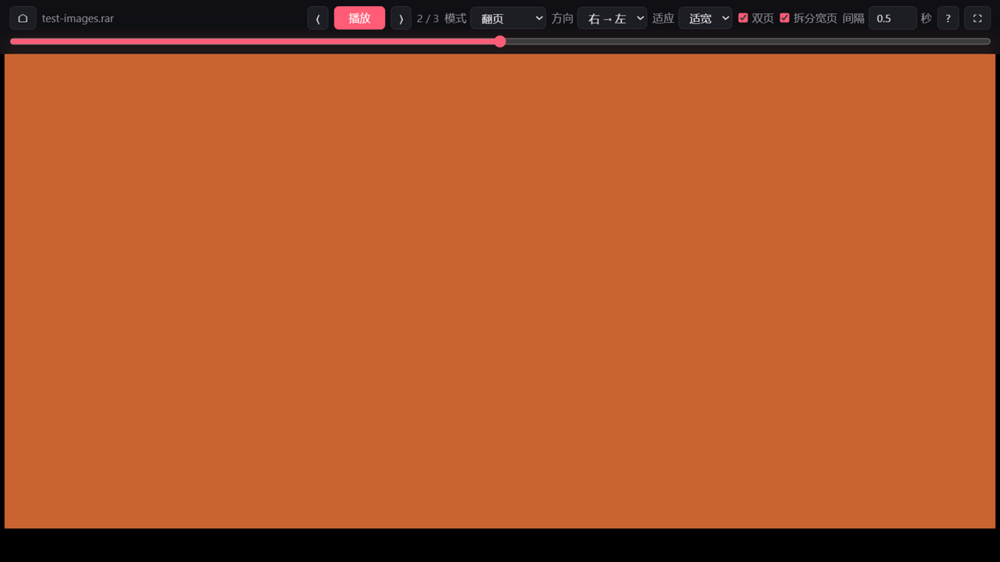

# 漫画播放器 (Manga Player)

**单文件、零安装、本地优先的漫画"播放器"。** 一个 HTML 文件（约 390 KB），双击打开，把压缩包拖进去，设好间隔就像看视频一样自动翻页。



## 特性

- 定时自动翻页（0.5s~1h 可调，随时暂停），条漫可切自动滚动模式
- ZIP / CBZ / RAR / CBR 直接读取，无需解压；加密 RAR 自动询问密码（RAR 4.x / 5.x，WASM 内嵌）
- 双页模式 + 宽页跨页图自动拆分；日漫右开方向
- 缩放平移、进度拖动条、全键盘操作、播放时屏幕常亮
- **每本书独立记忆**阅读进度与阅读设置
- 支持 webp / jpg / png / gif / bmp / avif，兼容 GBK 文件名的老压缩包
- 纯本地运行，无网络请求

## 使用

下载 [`漫画播放器.html`](漫画播放器.html) → 双击（Edge / Chrome）→ 拖入压缩包或文件夹 → 按空格播放。

| 按键 | 功能 |
| --- | --- |
| `空格` | 播放 / 暂停 |
| `←` `→` | 翻页（日漫方向下相反） |
| `Home` / `End` | 首页 / 末页 |
| `+` / `−` | 调整翻页间隔 |
| `Ctrl` + 滚轮 | 缩放（拖动平移，双击复位） |
| `F` / `?` / `Esc` | 全屏 / 帮助 / 返回 |

鼠标：点击图片左 / 右半边翻页；整页模式下滚轮翻页。完整说明见程序内帮助（`?`）。

## 格式支持

ZIP / CBZ / RAR / CBR / 图片文件夹 ✅ —— 加密 ZIP、7z、ZIP64（>4GB）、分卷 RAR ❌（解压成文件夹拖入即可）。

## 原理

- ZIP：手写中央目录解析 + 浏览器原生 `DecompressionStream`，懒解压 + 预加载窗口，大包秒开
- RAR：内嵌 [node-unrar-js](https://github.com/YuJianrong/node-unrar-js)（官方 unRAR 6.1.7 WASM），后台 Worker 流式解压
- 翻页计时用 `setInterval`（不受标签页遮挡影响），渲染带代数号防竞态，文件名按 UTF-8 / GBK 自动识别

## 开发

```bash
node build.mjs            # 从 src/ 构建单文件 漫画播放器.html
node test/zip_test.mjs    # ZIP 解析器测试
node test/rar_test.mjs    # RAR 提取测试
```

## 致谢与许可

- [node-unrar-js](https://github.com/YuJianrong/node-unrar-js)（MIT，内核为 Alexander Roshal 的官方 unRAR 6.1.7）
- 设计参考：[kthoom](https://github.com/codedread/kthoom)、[Mihon](https://github.com/mihonapp/mihon)
- 本项目代码以 [MIT](LICENSE) 发布
